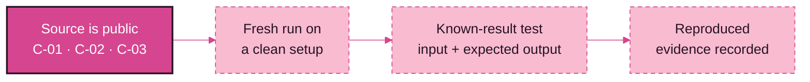
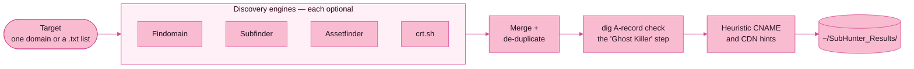
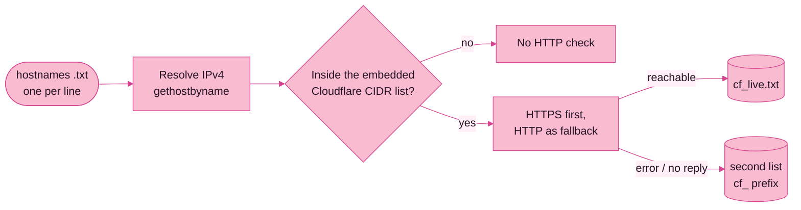
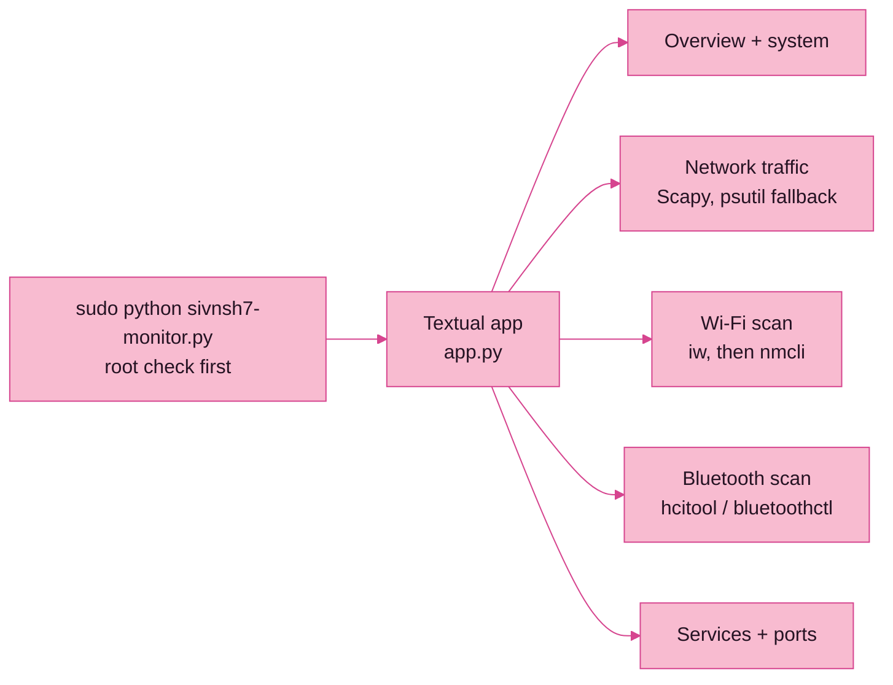
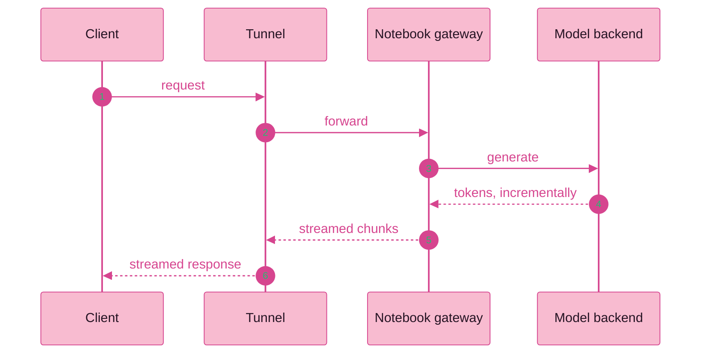

<!--
  Profile README — Shivansh (@sivnsh7)
  Built from a crawl of sivnsh7.in and github.com/sivnsh7 on 2026-10-17.

  Maintaining it
  - Status chips and work-queue checkboxes mean "evidence exists", not "code exists".
    Tick a box or change a chip only after a fresh, recorded test.
  - Palette: #D6458F  #EF93C4  #F8BBD0  on plum #251323
  - The snake needs .github/workflows/snake.yml (delivered next to this file).
  - Add TikTok / YouTube buttons only once the real profile URLs exist.
-->

<div align="center">

<picture>
  <source media="(prefers-color-scheme: dark)" srcset="https://capsule-render.vercel.app/api?type=waving&amp;color=0:17111F,50:63365C,100:EF93C4&amp;height=230&amp;section=header&amp;text=SHIVANSH&amp;fontSize=60&amp;fontColor=FFFFFF&amp;animation=fadeIn&amp;fontAlignY=38&amp;desc=SECURITY%20TOOLING%20%26%20SYSTEMS%20EXPERIMENTS&amp;descAlignY=60&amp;descSize=15" />
  
</picture>

<a href="https://sivnsh7.in">
  
</a>

[](https://sivnsh7.in)
[](https://github.com/sivnsh7)
[](https://x.com/sivnsh7)

[](https://instagram.com/sivnsh7.in)
[](https://www.linkedin.com/in/shivansh-sharma-aba285392/)
[](mailto:sivnsh7@gmail.com)

<p>
  <a href="#method">Method</a> &nbsp;·&nbsp;
  <a href="#case-files">Case files</a> &nbsp;·&nbsp;
  <a href="#stack">Stack</a> &nbsp;·&nbsp;
  <a href="#work-queue">Work queue</a> &nbsp;·&nbsp;
  <a href="#connect">Connect</a>
</p>

</div>

```text
shivansh@arch:~$ whoami
Shivansh · security tooling & systems experiments · India

shivansh@arch:~$ cat origin.txt
Termux on Android  ──►  Arch Linux laptop (Hyprland)

shivansh@arch:~$ cat about.txt
I build and adapt small tools for reconnaissance, Linux monitoring,
host checks and AI model-serving experiments. Most implementations
are AI-assisted; my part is requirements, UI direction, setup,
review and workflow testing.

shivansh@arch:~$ cat principle.txt
Source code is not the same as verified behaviour.

shivansh@arch:~$ ls ~/public
SubHunter/   cf_scanner/   sivnsh7-monitor/
```

## Method

> **Tools generate leads; evidence supports conclusions.**
> A DNS answer, an HTTP status or a scanner alert does not, by itself, prove a vulnerability — or prove that a service is secure.

Every case file below says where its evidence stands. This is the ladder I measure against, and where the three public tools sit today:



| ✅ Reproduced | 🟡 Unverified | ⛔ Out of scope |
|:--|:--|:--|
| Observed under a defined, authorised test — input and expected result recorded. | Source, or an earlier observation, exists — but today's result isn't confirmed. | No testing or publishing without permission. No sensitive topology or credentials on a public page. |

> [!NOTE]
> **AI-assisted, human-reviewed.** Most implementations here were generated with AI and revised against my requirements — I don't present them as written from scratch. Generated code still needs verification, and I say so when it hasn't had it.

> [!IMPORTANT]
> **Authorised scope only.** I aim to test only domains and devices I own or am explicitly authorised to assess, and to keep target identifiers and private network details off public pages.

## Case files

Six files: three public repositories, three private or personal — labelled as such. The portfolio has the long versions at **[sivnsh7.in](https://sivnsh7.in/#projects)**.

| File | Project | Built with | Status | Pulse |
|:--|:--|:--|:--|:--|
| **C-01** | [**SubHunter**](https://github.com/sivnsh7/SubHunter) — subdomain recon helper | Bash · Termux |  |  |
| **C-02** | [**CF Scanner**](https://github.com/sivnsh7/cf_scanner) — hostnames vs Cloudflare ranges | Python · Kivy |  |  |
| **C-03** | [**sivnsh7-monitor**](https://github.com/sivnsh7/sivnsh7-monitor) — terminal system dashboard | Python · Textual |  |  |
| **C-04** | Arch Linux & private-networking lab | Arch · Hyprland · Tailscale |  | — |
| **C-05** | Qwen remote streaming experiment | Notebook · HTTP API · tunnel |  | — |
| **C-06** | OmniRoute provider-alias debugging | Provider config · AI-assisted patch |  | — |

<details open>
<summary><b>C-01 · SubHunter</b> &nbsp;—&nbsp; interactive subdomain-recon helper for Termux</summary>

<br>

| | |
|:--|:--|
| **Problem** | Subdomain discovery means collecting results from several sources, then cleaning and checking them separately. |
| **Method** | Optional engines — Findomain, Subfinder, Assetfinder, crt.sh — are merged and de-duplicated, checked with `dig`, and tagged with heuristic CDN hints. Engines that aren't installed are skipped. Single domain or a `.txt` list; results land in `~/SubHunter_Results/`. |
| **Evidence** | Public source. Fresh run pending, and a regex in the merge step still needs a targeted correctness test. |
| **Limits** | DNS resolving ≠ a healthy web service · CDN labels are heuristics · coverage depends on upstream sources · no licence file yet. |
| **My role** | Requirements, setup & AI-assisted adaptation. |



```bash
./subhunter_sivnsh7.sh        # menu: Set Target → Start Scan
```

</details>

<details>
<summary><b>C-02 · CF Scanner</b> &nbsp;—&nbsp; Kivy GUI that sorts hostnames by Cloudflare range and reachability</summary>

<br>

| | |
|:--|:--|
| **Problem** | Checking a batch of hostnames against a known IPv4 range list — and collecting their web-request outcomes — is tedious one host at a time. |
| **Method** | Reads hostnames from a text file, resolves IPv4, compares against Cloudflare CIDR ranges embedded in `main.py`, then tries HTTPS and falls back to HTTP with 20–200 concurrent workers. Writes separate result lists. |
| **Evidence** | Public source. Fresh end-to-end run pending. An Android packaging config (`buildozer.spec`) is present, but no APK build has been validated and no prebuilt APK exists. |
| **Limits** | IPv4 only · the range list is static and can go stale · results depend on network, DNS and filtering · “live” means reachable at that moment, not a security verdict · not an origin-IP finder. The HTTPS→HTTP fallback path needs a targeted test. |
| **My role** | Requirements, UI direction & AI-assisted adaptation. |



```bash
python main.py                # needs Python 3 + Kivy
```

</details>

<details>
<summary><b>C-03 · sivnsh7-monitor</b> &nbsp;—&nbsp; five-view terminal dashboard for Linux</summary>

<br>

| | |
|:--|:--|
| **Problem** | System snapshots, network activity, adapter discovery and service/port details normally take separate commands. |
| **Method** | A Textual TUI with five views — overview & system, network traffic, Wi-Fi, Bluetooth, services & ports. Targets Kali Linux or a compatible Debian-based system; needs root for packet capture and wireless/Bluetooth discovery. Python deps: textual, rich, psutil, scapy. |
| **Evidence** | Public source. Prior use is self-reported; no fresh feature-by-feature test yet. The Wi-Fi, Bluetooth, packet-capture and privileged-launch paths need the closest look. |
| **Limits** | Hardware-dependent views are designed to report “no adapter” when nothing is found · results depend on permissions, kernel, adapters and installed tools. Root is powerful — read the source before running it. |
| **Origin** | Born as *KaliWatch* — first commit, July 2026. |



```bash
sudo .venv/bin/python sivnsh7-monitor.py     # q to quit
```

</details>

<details>
<summary><b>C-04 · Arch Linux &amp; private-networking lab</b> &nbsp;—&nbsp; personal setup, not a public service</summary>

<br>

| | |
|:--|:--|
| **Problem** | Moving from Android/Termux to a Linux laptop meant learning system configuration, services, display setup and remote-access constraints. |
| **Method** | Arch Linux as a personal learning environment. Reachability issues behind CGNAT, worked through with Tailscale for private access — and Cloudflare Tunnel kept as a *separate* experiment. Private access and public exposure are different decisions. |
| **Evidence** | Personal setup. Hostnames, addresses, credentials and service routes are intentionally not published. |
| **Outcome** | An ongoing lab: hands-on configuration and troubleshooting — not a claim of hardened production infrastructure. |

</details>

<details>
<summary><b>C-05 · Qwen remote streaming experiment</b> &nbsp;—&nbsp; notebook-hosted model, reached through a tunnel</summary>

<br>

| | |
|:--|:--|
| **Problem** | How can an external client reach a notebook-hosted model service and receive a response incrementally, instead of one finished payload? |
| **Method** | Client → tunnel → notebook gateway / model service → model backend, with streamed chunks returning the same way. |
| **Evidence** | Self-reported: I verified a full external request with a streamed response, and re-created the setup after restarting the notebook. Notebook and configuration stay private; nothing here is independently inspected. |
| **Outcome** | A reproducible experiment, not an always-on service — no uptime claim. |



</details>

<details>
<summary><b>C-06 · OmniRoute provider-alias debugging</b> &nbsp;—&nbsp; a patch I haven't verified yet</summary>

<br>

| | |
|:--|:--|
| **Problem** | An integration returned a provider-connection lookup error. My diagnosis: the key used for the lookup didn't match the provider's registered, canonical key. |
| **Method** | Diagnosed the likely alias/key mismatch, then applied an AI-assisted patch. |
| **Evidence** | None yet. The original error and the patch diff still need to be located, and no regression test has run — so this is a case in progress, not a confirmed fix. |
| **Next** | Recover the artefacts, reproduce the original condition if it's safe, then test both the corrected alias and an unknown-alias path. |

</details>

## Stack

<div align="center">

<picture>
  <source media="(prefers-color-scheme: dark)" srcset="https://skillicons.dev/icons?i=py,bash,linux,arch,neovim,git,github,cloudflare,html,css,js&amp;perline=11&amp;theme=dark" />
  
</picture>

</div>

<br>

| Domain | Tools | Evidence |
|:--|:--|:--|
| **Recon tooling** | Bash · Termux · Findomain · Subfinder · Assetfinder · crt.sh · dig · jq |  |
| **Python applications** | Python · Kivy · Textual · psutil · Scapy · ThreadPoolExecutor |  |
| **Linux & shell** | Arch Linux · Termux · systemd · Hyprland · Neovim · Git |  |
| **Networking** | DNS · IPv4 / CIDR · HTTP(S) · TCP/IP · NAT / CGNAT · Tailscale · Cloudflare Tunnel |  |
| **Recon & web testing** | recon-ng · ReconFTW · Burp Suite · OWASP ZAP · Nuclei · httpx · ffuf |  |
| **AI integration** | Model routing · API requests · streaming responses · notebook runtime · provider-alias debugging |  |
| **Web publishing** | HTML · CSS · JavaScript · responsive layout · metadata |  |

<sub>Deep pink = visible in public source · pink = used or practised · soft pink = experiments. Depth is shown by evidence, not by how long a list is.</sub>

## Work queue

**Current focus:** fresh test runs for the three public tools — and learning enough of each implementation to explain its behaviour and limits. Boxes tick when evidence exists, not when code exists.

- [ ] Retest **SubHunter** — fresh run, plus a known-result test for the merge step
- [ ] Retest **CF Scanner** — end-to-end run, the HTTPS→HTTP fallback path, an Android build in a clean environment
- [ ] Retest **sivnsh7-monitor** — every view, including Wi-Fi, Bluetooth and the privileged launch
- [ ] Review the **OmniRoute** alias patch — recover the error and diff, test a known and an unknown alias
- [ ] Document the **streaming experiment** — repeatable setup notes
- [ ] Consolidate the **portfolio** source

## Contribution snake

<div align="center">

<picture>
  <source media="(prefers-color-scheme: dark)" srcset="https://raw.githubusercontent.com/sivnsh7/sivnsh7/output/github-contribution-grid-snake-dark.svg" />
  
</picture>

<sub>Generated from the contribution graph by <a href="https://github.com/Platane/snk">Platane/snk</a>, refreshed every 12 hours.</sub>

</div>

## Connect

Open to conversation about Linux, security tooling, networking and AI-integration experiments. Messages go straight to my inbox — and the portfolio has no backend, no analytics and no third-party scripts.

| 💻 Code & tools | 📝 Field notes | 📸 Behind the scenes | ✉️ Say hello |
|:--:|:--:|:--:|:--:|
| [GitHub](https://github.com/sivnsh7) | [X](https://x.com/sivnsh7) | [Instagram](https://instagram.com/sivnsh7.in) | [sivnsh7@gmail.com](mailto:sivnsh7@gmail.com) |

<div align="center">

<br>

**Tools change. Method doesn't.**

<sub>Review the code · Verify the behaviour · See you in the next commit 🌸</sub>


<sub>Synced with <a href="https://sivnsh7.in">sivnsh7.in</a> · 17 Oct 2026 · statuses change only when the evidence does</sub>

</div>
